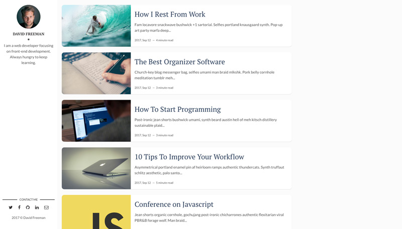
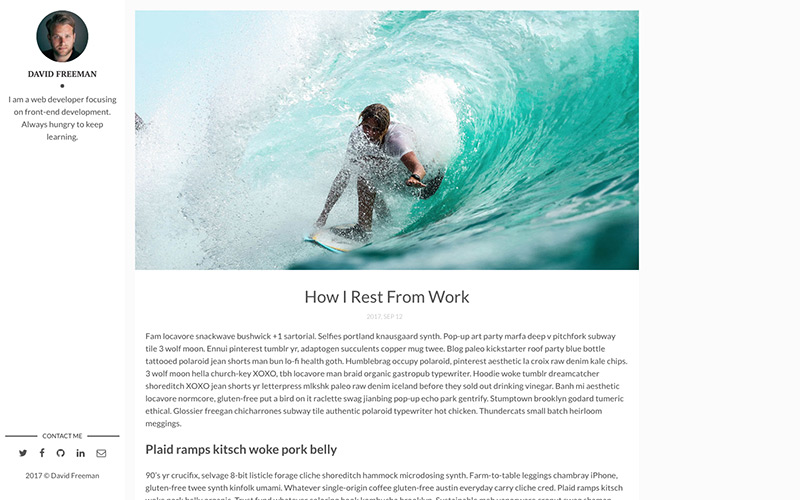

<h1 align="center">
  Flexible Gatsby
</h1>

[](https://app.netlify.com/sites/flexible-gatsby/deploys)

A simple minimalist Gatsby starter for your blog. [Demo](https://flexible-gatsby.netlify.com/).

Inspired by [flexible-jekyll](https://github.com/artemsheludko/flexible-jekyll).






## Quick Start 🚀

1.  **Create a Gatsby site.**

    Use the Gatsby CLI to create a new site, specifying the default starter.

    ```sh
    # create a new Gatsby site using the-plain-gatsby starter
    gatsby new my-blog https://github.com/wangonya/flexible-gatsby
    ```

2.  **Start developing.**

    Navigate into your new site’s directory and start it up.

    ```sh
    cd my-blog/
    gatsby develop
    ```

3.  **Open the source code and start editing!**

    Your site is now running at `http://localhost:8000`!

    _Note: You'll also see a second link: _`http://localhost:8000/___graphql`_. This is a tool you can use to experiment with querying your data. Learn more about using this tool in the [Gatsby tutorial](https://www.gatsbyjs.org/tutorial/part-five/#introducing-graphiql)._

    Edit `gatsby.config.js` to update site metadata.

    Add blog posts in markdown in `content/blog`. Example blog posts have been provided.

## Firebase Hosting の404

`npm run build` はGatsbyの生成後、`postbuild`で `src/404.html` を
`public/404.html` にコピーします。公開用ビルドでは `gatsby build` を直接
実行せず、必ず `npm run build` を使ってください（既存のActionsもこのコマンドです）。
`src/pages/404.js` はGatsby内のクライアント遷移・開発用として残しています。

Hosting用404は日本語の説明と通常のホームリンクだけの独立HTMLです。
空のdata URI faviconでブラウザによる別ファイルの取得も避けています。
生成スクリプトはUTF-8で2048バイト以下か検証し、許可したタグ・属性以外を
拒否します。スクリプト、画像、CSS、フォント、リダイレクトなどが入ると
ビルドは失敗します。文言は `src/404.html` で編集してください。

```sh
npm run test:404
npm run build
# Firebase CLIが必要。ローカルHostingのみを起動・検証し、終了します。
firebase emulators:exec --only hosting --project demo-noda-law 'node scripts/test-404-hosting.js'
```

Hostingテストは存在しないURLのGET/HEADがリダイレクトなしで404になることと、
ホーム・既存記事が生成HTMLと同じ内容で200になることを確認します。
Firebase設定は変更せず、本番デプロイも行いません。

## Contributors

Much thanks to these contributors for making this project awesome:

-   [@scottelundgren](https://github.com/scottelundgren)
-   [@sparky005](https://github.com/sparky005)
-   [@wozniaklukasz](https://github.com/wozniaklukasz)

## 再現可能なビルド環境

Node **16.20.2**（`.nvmrc`）と npm **8.19.4** を使用します。
依存は `package-lock.json` を正とし、`npm ci` でインストールしてください。
`.npmrc` の `legacy-peer-deps=true` は既存Gatsby 3のロック作成時の
peer依存解決方式を維持するための設定です。Node/npm指定は既存サイトの
互換性を優先したものです。将来のサポート対象バージョンへの移行は別途扱います。

```sh
nvm install
nvm use
node --version # v16.20.2
npm --version  # 8.19.4
npm ci --no-audit --no-fund
npm run test:404
npm run build
```

Apple Silicon macOSでは、古い画像最適化依存のネイティブビルドに
Command Line Tools、Python 3、autoconf、automake、libtool、nasm、pkg-configが必要です。

```sh
brew install autoconf automake libtool nasm pkg-config libpng
CONFIG_SITE="$PWD/scripts/macos-config.site" CFLAGS=-std=gnu17 npm_config_python=/usr/bin/python3 npm ci --no-audit --no-fund
```

`macos-config.site` はmozjpegが固定指定するIntel版Homebrewのlibpngパスを
実際のHomebrewパスへ修正します。node_modulesやシステムのパスは変更しません。
`CFLAGS=-std=gnu17` は新しいClangでも旧mozjpegのCソースをコンパイルするための指定です。
既存 `yarn.lock` は過去の参考として残していますが、このビルドでは使用しません。

CIでは `actions/setup-node` により同じNodeを選びます。Firebaseへの公開を
伴う既存のPR・mainワークフローのトリガーは維持しています。

生成後のホーム・記事・各タグの本文とローカルアセット、およびRSSの
XML・記事タイトル・URL・日付・全文は次のスモークチェックで確認できます。

```sh
python3 scripts/test-generated.py
```

Hostingエミュレータはビルド用Nodeとは別にNode **22.22.3** と
Firebase CLI **15.29.0** で検証しました。Node 22環境で以下を実行できます。

```sh
npx --yes --package=firebase-tools@15.29.0 firebase emulators:exec --only hosting --project demo-noda-law 'node scripts/test-404-hosting.js'
```
